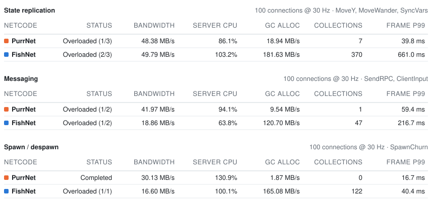

_Last run 2026-11-09: PurrNet 1.26.0-beta.7 · FishNet 4.7.3 · Unity 6000.5.4f1 · 2000 objects per test · 10 s windows · sessions 50c @ 30 Hz._

<picture>
  <source media="(prefers-color-scheme: dark)" srcset="latest-dark.svg">
  
</picture>

Same tables as text

**Who's ahead, 50 connections @ 30 Hz** (best per category; no averaging across categories)

| Category | Bandwidth | Server CPU | GC alloc |
|---|---:|---:|---:|
| State replication | tie | tie | tie |
| Messaging | – | – | – |
| Spawn / despawn | FishNet | tie | PurrNet |

**State replication** (50 connections @ 30 Hz · MoveY, MoveWander, SyncVars)

| Netcode | Status | Bandwidth | Server CPU | GC alloc | Collections | Frame p99 |
|---|---:|---:|---:|---:|---:|---:|
| PurrNet | Completed | 19.84 MB/s | 38.0% | 10.45 MB/s | 6 | 17.4 ms |
| FishNet | Overloaded (1/3) | 26.25 MB/s | 56.4% | 110.00 MB/s | 207 | 33.6 ms |

**Messaging** (50 connections @ 30 Hz · SendRPC, ClientInput)

| Netcode | Status | Bandwidth | Server CPU | GC alloc | Collections | Frame p99 |
|---|---:|---:|---:|---:|---:|---:|
| PurrNet | Overloaded (1/2) | 7.47 MB/s | 59.4% | 6.08 MB/s | 1 | 45.5 ms |
| FishNet | Overloaded (1/2) | 9.88 MB/s | 57.9% | 24.84 MB/s | 27 | 72.2 ms |

**Spawn / despawn** (50 connections @ 30 Hz · SpawnChurn)

| Netcode | Status | Bandwidth | Server CPU | GC alloc | Collections | Frame p99 |
|---|---:|---:|---:|---:|---:|---:|
| PurrNet | Completed | 14.45 MB/s | 66.3% | **1.43 MB/s** | **0** | **16.7 ms** |
| FishNet | Completed | **8.30 MB/s** | 66.9% | 109.12 MB/s | 127 | 24.7 ms |

Categories are reported separately, with no combined ranking. Bandwidth, CPU and allocation: averages; collections: total; frame p99: maximum. Categories that did not complete have no averages. Completed means the test finished. Overloaded means it finished but the server could not hold the 60 fps budget in that many tests (frame p99 past 33 ms or a sixth of frames dropped); its numbers are shown but never marked best, since they describe a saturated server. Idle and Static remain baselines; scaling requires the full suite.
Full results: [interactive report](https://purrnet.github.io/unity-netcode-benchmark/) · [workflow run](https://github.com/PurrNet/unity-netcode-benchmark/actions/runs/42598463271) · [raw datapoints](latest.json).
