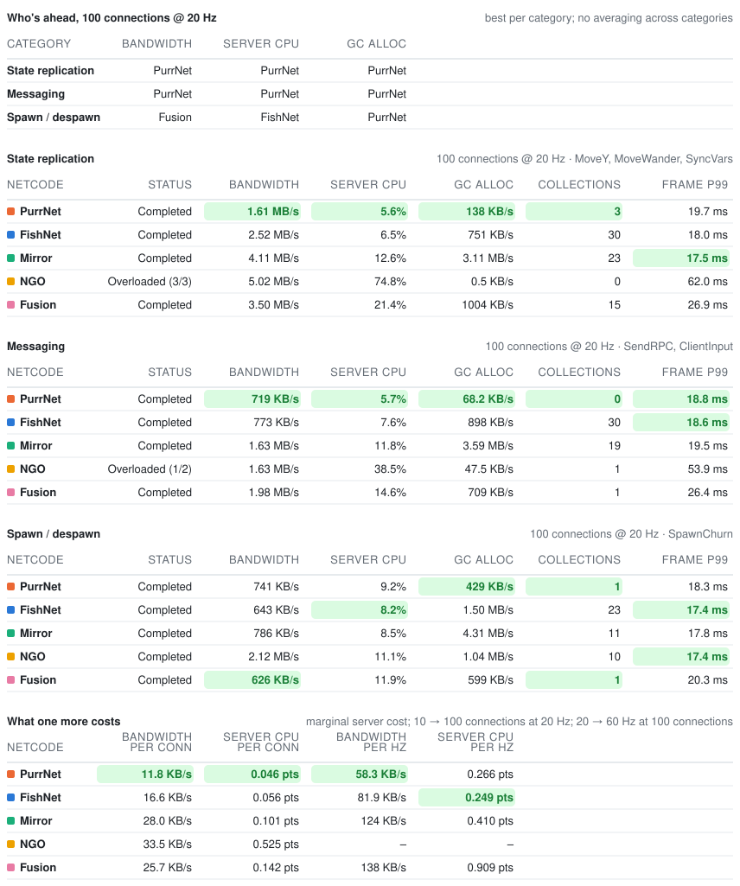

_Last run 2026-10-16: PurrNet 1.24.2-beta.15 · FishNet 4.7.3 · Mirror 96.0.1 · NGO 2.13.2 · Fusion 2.1.2 Stable 2279 · Unity 6000.5.4f1 · 100 objects per test · 10 s windows · sessions 10c @ 20 Hz / 100c @ 20 Hz / 100c @ 60 Hz._

_Note: NGO at 100c @ 60 Hz: resource limit exceeded (8 GiB memory)._

<picture>
  <source media="(prefers-color-scheme: dark)" srcset="latest-dark.svg">
  
</picture>

Same tables as text

**Who's ahead, 100 connections @ 20 Hz** (best per category; no averaging across categories)

| Category | Bandwidth | Server CPU | GC alloc |
|---|---:|---:|---:|
| State replication | PurrNet | PurrNet | PurrNet |
| Messaging | PurrNet | PurrNet | PurrNet |
| Spawn / despawn | Fusion | FishNet | PurrNet |

**State replication** (100 connections @ 20 Hz · MoveY, MoveWander, SyncVars)

| Netcode | Status | Bandwidth | Server CPU | GC alloc | Collections | Frame p99 |
|---|---:|---:|---:|---:|---:|---:|
| PurrNet | Completed | **1.61 MB/s** | **5.6%** | **138 KB/s** | **3** | 19.7 ms |
| FishNet | Completed | 2.52 MB/s | 6.5% | 751 KB/s | 30 | 18.0 ms |
| Mirror | Completed | 4.11 MB/s | 12.6% | 3.11 MB/s | 23 | **17.5 ms** |
| NGO | Overloaded (3/3) | 5.02 MB/s | 74.8% | 0.5 KB/s | 0 | 62.0 ms |
| Fusion | Completed | 3.50 MB/s | 21.4% | 1004 KB/s | 15 | 26.9 ms |

**Messaging** (100 connections @ 20 Hz · SendRPC, ClientInput)

| Netcode | Status | Bandwidth | Server CPU | GC alloc | Collections | Frame p99 |
|---|---:|---:|---:|---:|---:|---:|
| PurrNet | Completed | **719 KB/s** | **5.7%** | **68.2 KB/s** | **0** | **18.8 ms** |
| FishNet | Completed | 773 KB/s | 7.6% | 898 KB/s | 30 | **18.6 ms** |
| Mirror | Completed | 1.63 MB/s | 11.8% | 3.59 MB/s | 19 | 19.5 ms |
| NGO | Overloaded (1/2) | 1.63 MB/s | 38.5% | 47.5 KB/s | 1 | 53.9 ms |
| Fusion | Completed | 1.98 MB/s | 14.6% | 709 KB/s | 1 | 26.4 ms |

**Spawn / despawn** (100 connections @ 20 Hz · SpawnChurn)

| Netcode | Status | Bandwidth | Server CPU | GC alloc | Collections | Frame p99 |
|---|---:|---:|---:|---:|---:|---:|
| PurrNet | Completed | 741 KB/s | 9.2% | **429 KB/s** | **1** | 18.3 ms |
| FishNet | Completed | 643 KB/s | **8.2%** | 1.50 MB/s | 23 | **17.4 ms** |
| Mirror | Completed | 786 KB/s | 8.5% | 4.31 MB/s | 11 | 17.8 ms |
| NGO | Completed | 2.12 MB/s | 11.1% | 1.04 MB/s | 10 | **17.4 ms** |
| Fusion | Completed | **626 KB/s** | 11.9% | 599 KB/s | **1** | 20.3 ms |

**What one more costs** (marginal server cost; 10 → 100 connections at 20 Hz; 20 → 60 Hz at 100 connections)

| Netcode | Bandwidth per conn | Server CPU per conn | Bandwidth per Hz | Server CPU per Hz |
|---|---:|---:|---:|---:|
| PurrNet | **11.8 KB/s** | **0.046 pts** | **58.3 KB/s** | 0.266 pts |
| FishNet | 16.6 KB/s | 0.056 pts | 81.9 KB/s | **0.249 pts** |
| Mirror | 28.0 KB/s | 0.101 pts | 124 KB/s | 0.410 pts |
| NGO | 33.5 KB/s | 0.525 pts | – | – |
| Fusion | 25.7 KB/s | 0.142 pts | 138 KB/s | 0.909 pts |

Categories are reported separately, with no combined ranking. Bandwidth, CPU and allocation: averages; collections: total; frame p99: maximum. Categories that did not complete have no averages. Completed means the test finished. Overloaded means it finished but the server could not hold the 60 fps budget in that many tests (frame p99 past 33 ms or a sixth of frames dropped); its numbers are shown but never marked best, since they describe a saturated server. Idle and Static remain baselines; scaling requires the full suite.
Full results: [interactive report](https://purrnet.github.io/unity-netcode-benchmark/) · [workflow run](https://github.com/PurrNet/unity-netcode-benchmark/actions/runs/38874109736) · [raw datapoints](latest.json).
